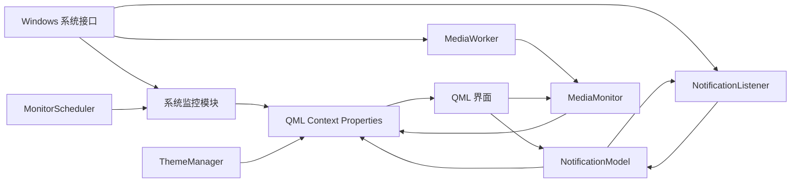

# 项目架构

## 技术栈

- Qt 6 Quick/QML：界面、布局、动画和用户交互；
- Qt Core：对象模型、信号槽、线程、定时器和设置存储；
- C++20：业务层和系统接口封装；
- C++/WinRT：通知监听和全局媒体会话；
- Windows API/PDH/IP Helper：CPU、内存、GPU 和网络数据；
- CMake：编译、QML 资源生成以及 MSIX 自定义目标；
- PowerShell：Qt 运行库部署、MSIX 制作、签名和安装。

## 启动流程

程序入口位于 `src/main.cpp`，主要步骤如下：

1. 初始化单线程 WinRT apartment；
2. 创建 `QGuiApplication` 和 `QQmlApplicationEngine`；
3. 创建所有监控器、通知、媒体和主题对象；
4. 将周期模块注册到 `MonitorScheduler`；
5. 连接通知监听器与通知模型的同步信号；
6. 注册媒体封面图片提供器；
7. 将后端对象作为 QML context property 暴露给界面；
8. 从 QML 模块 `qt_rainmeter` 加载 `Main`。

## 总体关系



## C++ 与 QML 的连接

`main.cpp` 暴露以下全局 QML 对象：

| QML 名称 | C++ 类型 | 主要用途 |
|---|---|---|
| `cpuMonitor` | `CpuMonitor` | CPU 使用率 |
| `memoryMonitor` | `MemoryMonitor` | 内存使用率 |
| `gpuMonitor` | `GpuMonitor` | GPU 使用率 |
| `networkMonitor` | `NetworkMonitor` | 上传、下载速率文本 |
| `diskMonitor` | `DiskMonitor` | 分区列表模型 |
| `mediaMonitor` | `MediaMonitor` | 媒体信息和控制命令 |
| `notificationModel` | `NotificationModel` | 通知列表和列表操作 |
| `themeManager` | `ThemeManager` | 主题模式和全部界面颜色 |
| `uiSettings` | `UiSettings` | 展开状态、当前页面和模块开关的持久化 |
| `focusTimer` | `FocusTimer` | 专注倒计时、预设时长与完成次数统计 |
| `systemTrayManager` | `SystemTrayManager` | Windows 主音量、静音和电池供电状态 |

界面直接绑定 `Q_PROPERTY`。后端属性变化时发出对应信号，QML 会自动刷新，不需要界面主动轮询。

`UiSettings` 和 `DisplayManager` 使用 `QSettings` 保存用户偏好。QML 只修改这两个应用级对象，避免在多个页面内分别维护易失状态；恢复默认布局时也由 `UiSettings::reset()` 统一触发属性通知。

`FocusTimer` 使用 250 ms 的内部定时器刷新基于绝对截止时间计算的剩余秒数，因此界面刷新延迟不会导致倒计时逐渐漂移。切换页面或收起窗口不会影响计时，完成次数和所选时长通过 `QSettings` 保存。

`SystemTrayManager` 通过 Windows Core Audio 的 `IAudioEndpointVolume` 读写默认播放设备的主音量，并通过 `GetSystemPowerStatus` 获取电池和充电状态。它每秒同步一次外部变化，QML 不调用外部命令。

媒体封面使用 `CoverImageProvider`，通过 `image://cover/current?<version>` 提供给 QML。查询参数中的版本号用于使图片源发生变化，从而刷新缓存。

## 周期调度

系统监控不再各自持有 `QTimer`。所有需要周期刷新的模块实现 `PeriodicModule::refresh()`，统一注册到 `MonitorScheduler`。

当前周期为：

| 模块 | 周期 |
|---|---:|
| CPU | 1000 ms |
| 内存 | 1000 ms |
| GPU | 1000 ms |
| 网络 | 1000 ms |
| 磁盘分区 | 5000 ms |

`MonitorScheduler` 内部维护一个 `QVector<Entry>` 和一个基础 `QTimer`。每次超时累加各条目的已用时间，到达模块周期后调用其 `refresh()`。`QPointer` 用于在 QObject 被销毁后避免访问失效模块。

## 线程模型

- 主线程：Qt GUI、QML、系统监控、通知模型和通知监听回调的 Qt 侧处理；
- 媒体线程：`MediaWorker` 被移动到独立 `QThread`，负责 WinRT 媒体会话查询与控制；
- 媒体线程通过 queued connection 将标题、艺术家、专辑、提供者、封面和播放状态传回 `MediaMonitor`；
- QML 发出的播放、暂停、上一首和下一首操作，也通过 `QMetaObject::invokeMethod` 排队发送给工作线程。

## 通知同步数据流

系统新增或更新通知：

```text
Windows UserNotificationListener
  → NotificationListener
  → notificationAdded/notificationUpdated
  → NotificationModel::addNotification
  → QML ListView
```

界面删除通知：

```text
QML
  → NotificationModel::removeNotification
  → removalRequested
  → NotificationListener::removeNotification
  → Windows 通知中心
```

系统侧删除通知时，`notificationRemoved` 会调用 `NotificationModel::removeById`，从而同步移除界面项目。清空操作也会经由 `clearRequested` 调用 Windows 的 `ClearNotifications()`。

## QML 页面层级

```text
Main
└─ Sidebar
   ├─ Timebar
   ├─ StackLayout
   │  ├─ DashboardPage
   │  ├─ SystemMonitorPanel
   │  │  ├─ SystemMetricGauge × 3
   │  │  ├─ 网络速率卡片
   │  │  └─ DiskPanel
   │  └─ 通知与媒体页面
   │     ├─ MediaBar
   │     └─ NotificationArea
   │        └─ NotificationItem × N
   │  └─ FocusPage
   └─ SystemControlBar
```

`Main` 创建无边框、置顶、工具窗口，并根据 `DisplayManager` 将窗口固定在用户选择的显示器左侧或右侧。展开宽度可在 360–560 像素之间调整，折叠后保留 6 像素触发区域。

